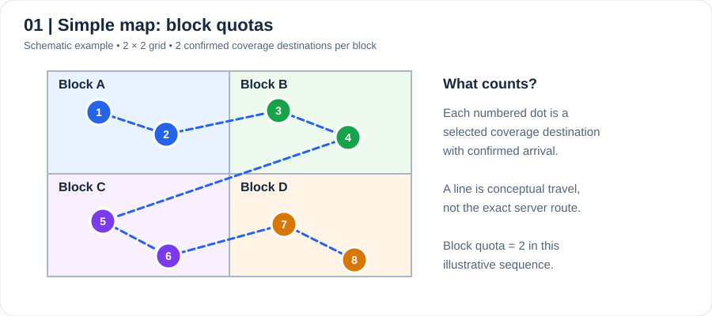
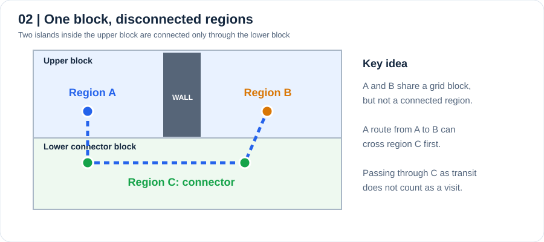
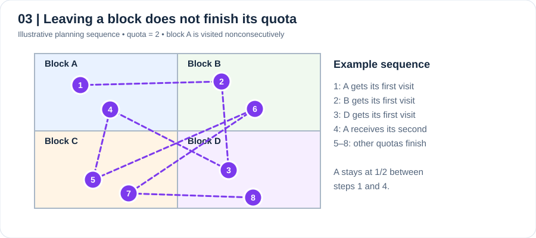
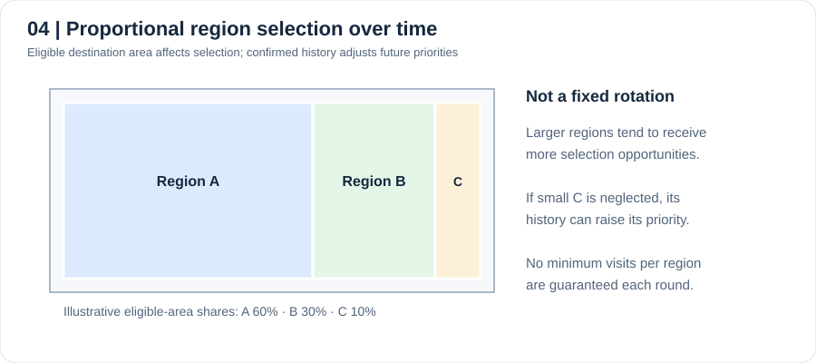
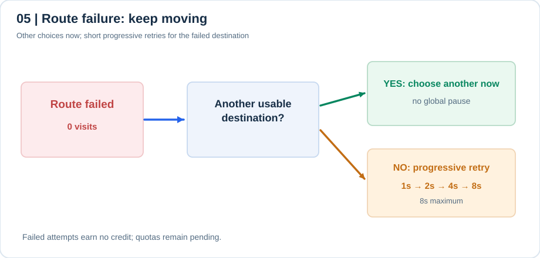
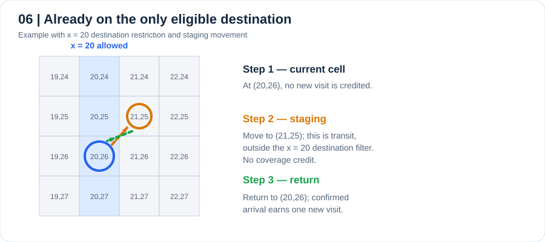

# 🗺️ lockMapSweep

**Smarter map exploration for [OpenKore](https://github.com/OpenKore/openkore)**
**Version 2.1.0** · **English** | [Português](README.pt-BR.md)

OpenKore's `randomWalk` moves your character, but random destinations do not necessarily spread exploration across a map. **lockMapSweep** organizes destination selection: it divides navigable ground into blocks, recognizes obstacles and connected regions, remembers which areas still need visits, and considers travel costs when choosing where to go next.

**The plugin decides *where* to explore; OpenKore calculates and executes *how* to get there.** It is not a fixed patrol route or a replacement for combat, NPC, or general navigation features.

## Quick start

1. Place `lockMapSweep.pl` in your OpenKore plugin directory.
2. Configure `lockMap` and normal `randomWalk` behavior in `control/config.txt`.
3. Add the following options for a **3 × 3 grid** and **2 coverage destinations per block per round**:

   ```text
   lockMapSweep_enabled 1
   lockMapSweep_blocksX 3
   lockMapSweep_blocksY 3
   lockMapSweep_cellsPerBlock 2
   lockMapSweep_useStateFile 1
   ```

4. Launch OpenKore and enter `lockMapSweep status` to inspect the current plan.


## Three concepts to know

| Concept | Meaning |
| --- | --- |
| **Block** | A section of the configured grid. Each block has a coverage-visit quota per round. |
| **Region** | A connected area inside a block. Walls or other obstacles can split one block into multiple regions. |
| **Coverage visit** | A confirmed arrival at a destination deliberately selected for coverage. Only this counts toward the block quota. |

A **round** finishes once the applicable block quotas have been met. For example, four blocks with a quota of two visits each call for up to eight confirmed coverage arrivals, subject to the valid destinations available in each block.

**Passing through an area is not automatically a coverage visit.** The character may cross a corridor, an intermediate region, or a finished block simply to reach another destination. That movement is **transit** and does not increment visit counts.

## Visual examples: from simple to complex maps

These illustrations show possible planner decisions, not guaranteed patrol patterns. Dashed lines explain the idea of movement, not the exact path the game will execute. Numbered points indicate an example sequence, not a mandatory order.

### 1. Open map: cover it block by block



Imagine an open map divided into **four blocks** with `lockMapSweep_cellsPerBlock 2`.

- The plugin picks valid destination cells in the blocks.
- Each confirmed arrival fulfills one of that block's two required visits.
- Once the round's quotas are complete, a new exploration round begins.

**Why it helps:** destinations are chosen with awareness of which parts of the map have already received attention. There is still randomness, but also block-level progress.

### 2. Fragmented map: two regions inside one block



A wall separates **A** and **B** within the upper block. To move from A to B, the character must first travel through **C** in the lower block and approach from the other side.

- The plugin treats A and B as separate regions even though they share a block.
- It considers transit through C when planning access to B.
- If C is only used for transit, **C receives no coverage credit**.

**Why it helps:** a block boundary does not trick the planner into assuming every part of that block is directly connected. This is how it handles irregular, fragmented maps.

### 3. Interrupted block quotas: leave and return later



With two visits required per block, the character might visit **A** once, move through **B** and **D**, then return to **A** later.

- Leaving A at `1/2` does not reset its progress.
- The planner still knows A needs one more visit.
- Finished blocks may be crossed on the way to other destinations without receiving extra visits.

**Why it helps:** exploring a map does not require finishing every block before leaving it. The plugin can take useful opportunities while keeping outstanding obligations.

### 4. Unequal regions: balance opportunities over time



Suppose regions **A**, **B**, and **C** contain 60%, 30%, and 10% of eligible destinations. Larger regions generally offer more opportunities, but the plugin also considers confirmed-visit history to give relatively neglected regions more attention.

This **does not** prescribe six visits to A, three to B, and one to C out of every ten. Selection is probabilistic, depends on available paths, and varies across rounds.

**Why it helps:** small corners remain part of the planning process rather than disappearing behind much larger areas.

### 5. Failed destination: retry without losing the round



A canceled, stuck, or failed route **does not** count as a visit. The failed destination is temporarily excluded. If every remaining eligible destination has failed, the plugin pauses retries for **30 seconds**.

- When other eligible destinations remain available, the plugin can continue exploring them instead of repeating the failed route.
- After the cooldown, failed destinations can be reconsidered. The plugin retains outstanding quotas while waiting rather than repeatedly requesting routes.
- If access remains impossible, the visit stays pending. The planner does not manufacture an arrival to finish the round.

**Why it helps:** temporary navigation problems need not erase progress or produce endless immediate retry loops.

### 6. Single destination: move away and come back



Imagine a restriction that permits just **one coverage destination**, at `(20,26)`. After a round ends, the character is still standing there. Remaining on the cell **must not** count as a new visit.

The plugin looks for a nearby walkable staging cell, moves the character there, for example to `(21,25)`, then returns to `(20,26)`:

- **Moving away:** transit, worth **zero visits**.
- **Confirmed return:** worth **one visit** in the new round.
- Staging can be outside configured **destination** restrictions because it is not a coverage destination.

The staging search is bounded to **eight route-cost steps**. If no legal staging cell exists, the obligation remains pending, the plugin reports the blockage, and retries are considered after 30 seconds.

**Why it helps:** even a one-cell coverage area cannot generate visits merely because the character is standing still.

## How does it choose the next destination?

The planner follows this process:

1. **Find walkable ground.** Use OpenKore movement rules to identify the component connected to the character and exclude unreachable islands.
2. **Build blocks and regions.** Create the block grid and detect areas separated by obstacles within those blocks.
3. **Check outstanding visits.** Consult each block's confirmed count and available destinations for the current round.
4. **Compare travel opportunities.** Consider nearby regions, arrival and continuation costs, history, and outstanding coverage. Strategic transit waypoints can help approach distant regions.
5. **Ask OpenKore to route.** OpenKore uses its normal navigation system to execute movement.
6. **Update after the outcome.** A confirmed coverage arrival counts; transit and failed routes do not. The plan can be reconsidered as the character moves.

The planner **does not follow a fixed block order** or guarantee the globally shortest route. It can defer a connected region when the optional detour would be too costly.

### What counts as a visit?

| Event | Counts? |
| --- | :---: |
| Confirmed arrival at the selected coverage destination | ✅ |
| Passing through an intermediate block, corridor, or region | ❌ |
| Reaching a strategic transit waypoint | ❌ |
| Queuing a route that has not finished | ❌ |
| An interrupted or failed route | ❌ |
| Standing still on the only eligible destination | ❌ |
| Moving away and making a confirmed return | ✅ |

## Configuration

| Option | Default | Purpose |
| --- | --- | --- |
| `lockMapSweep_enabled` | `0` | Set to `1` to enable the plugin. |
| `lockMapSweep_blocksX` | `2` | Number of blocks across the map. |
| `lockMapSweep_blocksY` | `2` | Number of blocks vertically. |
| `lockMapSweep_cellsPerBlock` | `3` | Maximum confirmed coverage visits per block per round. Blocks with fewer eligible destinations may have lower quotas. |
| `lockMapSweep_useStateFile` | `1` | `1` persists progress between runs; `0` keeps it only in memory. |
| `lockMapSweep_stateDir` | `plugins/lockMapSweep/state` | Saved-state directory. |

### Working with `lockMap`

The plugin respects `lockMap`, `lockMap_x`, `lockMap_y`, `lockMap_randX`, `lockMap_randY`, and destinations excluded through OpenKore's `add_dropDestinationCells` hook.

These settings restrict **where a coverage visit may end**, not every walkable cell the character can travel through. This is why a route can cross other blocks or corridors, and temporary staging may leave the destination-restricted area without enlarging the set of valid coverage targets.

The plugin is active only while enabled and the character is on the configured `lockMap`. It does not set the map for you, teleport, or replace unrelated OpenKore behavior.

## Console commands

| Command | Effect |
| --- | --- |
| `lockMapSweep status` | Shows the map, planning state, current block, and visit counters. |
| `lockMapSweep rebuild` | Rebuilds the plan using current map data and settings. If rebuilding fails, the previous valid in-memory plan is retained, although incompatible settings can pause exploration. |
| `lockMapSweep clearstate` | Deletes the saved state file **without immediately resetting** the in-memory plan. A later state write may recreate the file. |

## Saved progress and special situations

With `lockMapSweep_useStateFile 1`, the plugin can restore confirmed block visits, regional history, outstanding quotas, failed destinations, and pending routes. When necessary, it also records move-away and return phases.

On startup it checks that the saved state matches the current map and settings. Incompatible or invalid state is rebuilt instead of being trusted. Changes to geometry, the grid, or destination restrictions can therefore restart recorded progress.

## Compatibility

lockMapSweep uses OpenKore plugin hooks, map field walkability data (`.fld2`), and its native `randomWalk`/`ai_route` interfaces. The OpenKore installation must provide those interfaces and field data for the configured map. The plugin estimates connectivity and travel costs for planning; OpenKore still chooses and executes each native route, so estimated paths do not guarantee the exact movement or a successful arrival.

**Why might the character stop choosing destinations?** Failed routes may be waiting for their retry window, a reachable region may require a detour considered too costly at the moment, or no legal staging cell may exist. In some situations OpenKore can still use ordinary `randomWalk` as a fallback; during explicitly blocked recovery states the plugin suppresses that fallback to avoid uncontrolled movement.

**What it does not promise:** visiting every cell, distributing exactly equal visits among regions, reaching physically disconnected areas, or completing routes that OpenKore and the game server cannot execute.

## Changelog

### 2.1.0 — Global region-aware planning

- Blocks can contain **multiple separately connected regions**, including regions reachable only by traveling through another block.
- Exploration no longer requires finishing a block before moving on: **partial visit quotas remain pending** and may be resumed later.
- Destination selection now considers **proportional regional history**, travel costs, and **strategic transit** across the map.
- Saved progress includes the information needed to resume **quotas, regional history, pending routes, and route-failure recovery**.
- Failed destinations can be reconsidered after **30 seconds**, without counting attempts as visits.
- When the only eligible destination is already occupied, the next visit requires a **real departure and confirmed return**, not stationary credit.

### 2.0.0 — Block navigation and confirmed arrivals

- Configurable map blocks and walkable destination selection.
- Progress counts only **confirmed arrivals**, not route requests.
- Destination restrictions, responses to map/configuration changes, and basic recovery from interrupted routes.
- Saved-state compatibility checks and safer file replacement.

---

*lockMapSweep organizes exploration destinations. OpenKore and the game server remain responsible for executing movement.*
