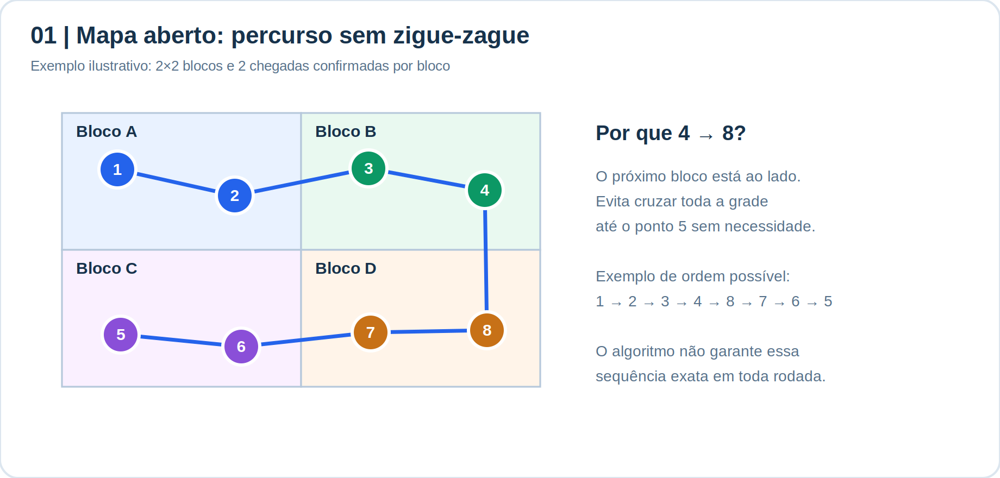
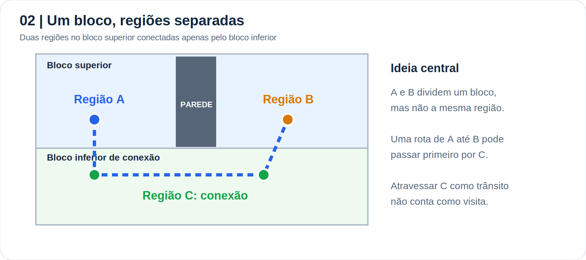
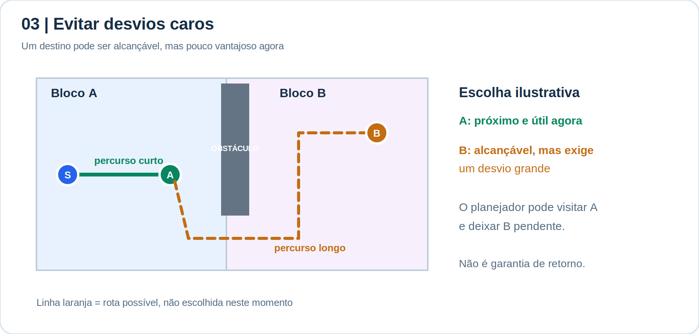
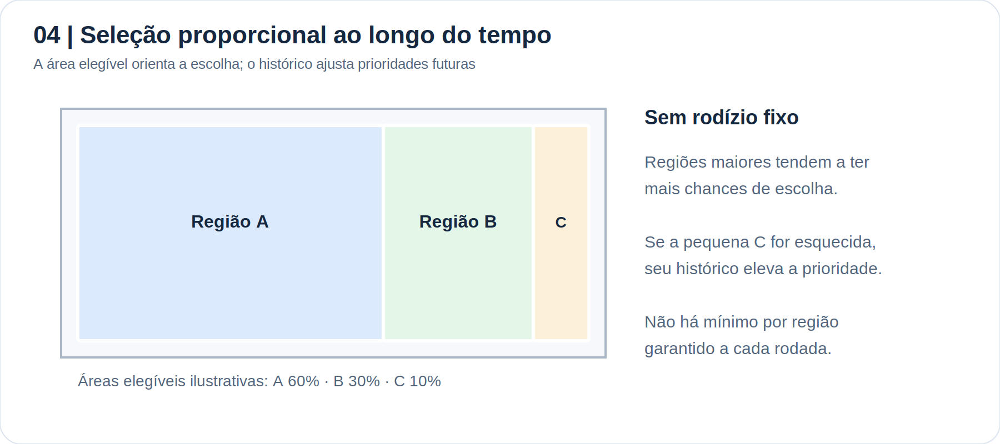
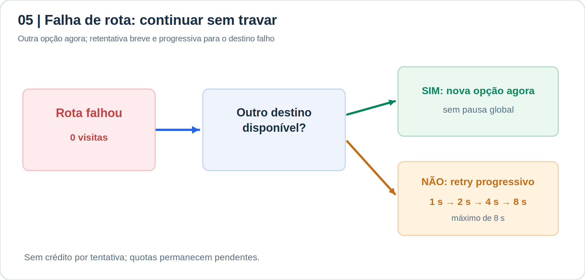
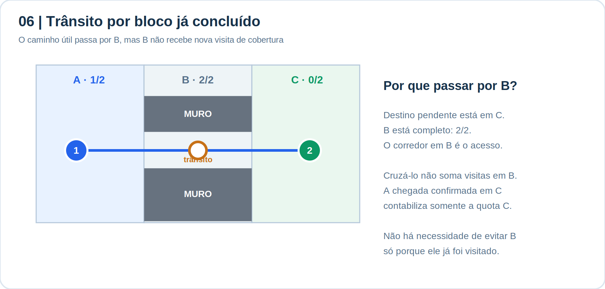

# 🗺️ lockMapSweep

**Exploração inteligente de mapas para [OpenKore](https://github.com/OpenKore/openkore)**

**Versão 2.1.0** · [English](README.md) | **Português**

O `randomWalk` do OpenKore faz o personagem caminhar, mas nem sempre distribui bem seus destinos pelo mapa. O **lockMapSweep** organiza essa exploração: divide a área navegável em blocos, reconhece caminhos e obstáculos, lembra quais partes ainda precisam de visitas e escolhe novos destinos levando em conta o deslocamento necessário.

**O plugin escolhe *onde* explorar; o OpenKore calcula e executa *como* chegar lá.** Não é uma rota fixa nem um substituto para as funções de combate, NPCs ou navegação geral.

## Comece por aqui

1. Coloque `lockMapSweep.pl` no diretório de plugins da sua instalação do OpenKore.
2. Configure o `lockMap` e o `randomWalk` normalmente em `control/config.txt`.
3. Adicione as opções abaixo para começar com uma grade de **3 × 3 blocos** e **2 destinos por bloco em cada rodada**:

   ```text
   lockMapSweep_enabled 1
   lockMapSweep_blocksX 3
   lockMapSweep_blocksY 3
   lockMapSweep_cellsPerBlock 2
   lockMapSweep_useStateFile 1
   ```

4. Inicie o OpenKore e use `lockMapSweep status` para consultar o planejamento.


## Entenda as três ideias principais

| Conceito | O que significa |
| --- | --- |
| **Bloco** | Uma parte da grade configurada. Cada bloco tem uma quantidade de destinos a visitar por rodada. |
| **Região** | Uma área conectada dentro de um bloco. Muros ou obstáculos podem dividir um mesmo bloco em várias regiões. |
| **Visita de cobertura** | Chegada confirmada a um destino escolhido pelo plugin. Apenas ela conta para cumprir a quantidade de visitas do bloco. |

Uma **rodada** termina quando as quotas dos blocos aplicáveis são cumpridas. Por exemplo: com quatro blocos e quota de duas visitas por bloco, o objetivo de uma rodada é registrar até oito chegadas de cobertura, respeitando a quantidade de destinos disponíveis em cada bloco.

**As visitas de um bloco não precisam ser consecutivas.** Se o personagem sair do bloco antes de completar sua quota, o progresso permanece registrado e poderá ser completado em uma chegada posterior.

**Passar por um lugar não é o mesmo que visitá-lo para cobertura.** O personagem pode atravessar um corredor, uma região ou um bloco já concluído apenas para chegar a outro destino. Esse movimento é **trânsito** e não aumenta nenhum contador de visitas.

## Exemplos visuais: do mapa simples ao avançado

As figuras são representações didáticas de possíveis decisões do planejador. As linhas mostram a ideia do deslocamento, não o caminho exato que o servidor executará. Os números ilustram uma sequência possível, não uma ordem obrigatória.

### 1. Mapa aberto: explorar sem cruzamentos desnecessários



Com **quatro blocos** e `lockMapSweep_cellsPerBlock 2`, cada bloco tem até duas visitas de cobertura por rodada. Num mapa aberto, uma sequência ilustrativa coerente é **1 → 2 → 3 → 4 → 8 → 7 → 6 → 5**: após o ponto 4, o personagem já está próximo do bloco inferior direito, sem precisar atravessar toda a grade até o ponto 5.

O plugin considera os custos de deslocamento, as quotas pendentes e o histórico regional; portanto, **não garante exatamente essa ordem**. O exemplo mostra por que destinos vizinhos podem ser oportunidades melhores do que percursos longos sem necessidade.

### 2. Mapa recortado: duas regiões no mesmo bloco



Uma parede separa as regiões **A** e **B** do bloco superior. Para ir de A até B, o personagem precisa descer até **C**, no bloco inferior, e subir pelo outro lado.

- O plugin reconhece A e B como regiões diferentes, apesar de estarem no mesmo bloco.
- Considera a passagem por C ao planejar como alcançar B.
- Se C servir somente de passagem, **nenhuma visita é creditada a C**.

**O benefício:** o personagem não precisa tentar atravessar uma divisão impossível só porque duas células estão no mesmo bloco. É assim que o planejamento lida com mapas “picotados”.

### 3. Desvios caros: adiar pode ser mais eficiente



Imagine dois destinos de cobertura pendentes: **A** está no caminho próximo e **B** fica atrás de um obstáculo. Embora B seja alcançável por um corredor mais longo, tentar visitá-lo agora exigiria um grande desvio.

- O planejador considera o **custo do percurso**, não apenas a distância em linha reta no mapa.
- Pode escolher A primeiro e manter a obrigação de B pendente, sem inventar uma chegada.
- B poderá voltar a ser uma opção quando as condições de planejamento forem mais favoráveis. **Não existe garantia de que toda obrigação adiada seja atendida rapidamente ou mesmo em uma rodada específica.**

**O benefício:** não transformar a cobertura em uma sequência de desvios caros apenas para seguir uma ordem rígida. Os caminhos desenhados são ilustrativos e não reproduzem uma rota nativa garantida.

### 4. Regiões desiguais: cobrir sem esquecer os cantos



Suponha que as regiões **A**, **B** e **C** representem 60%, 30% e 10% dos destinos elegíveis. Em geral, regiões maiores terão mais oportunidades de escolha, mas o plugin também leva em conta o histórico para ajustar a prioridade das regiões pouco visitadas.

Isso **não** significa uma agenda de seis visitas em A, três em B e uma em C a cada dez destinos. As escolhas são probabilísticas, dependem do caminho disponível e podem mudar entre rodadas.

**O benefício:** regiões pequenas não desaparecem do planejamento só porque outras ocupam grande parte do mapa.

### 5. Destino falhou: continuar e tentar novamente com rapidez



Uma rota interrompida ou malsucedida **não conta como visita**. O destino que falhou não deve impedir o uso de outras opções disponíveis.

- **Há alternativas viáveis:** o planejador pode selecionar outra opção na próxima oportunidade, sem pausa global.
- **É preciso repetir uma tentativa falha:** o intervalo mínimo cresce de **1 s → 2 s → 4 s → 8 s**, limitado a 8 segundos para falhas consecutivas. O OpenKore pode levar mais tempo para processar a próxima oportunidade.
- **Todas as opções estão temporariamente indisponíveis:** as quotas permanecem pendentes; o plugin controla as retentativas sem disparar buscas completas ou rotas em loop a cada ciclo.
- **Uma rota permanece inviável:** a falha nunca é tratada como visita concluída.

A espera progressiva evita repetição excessiva de rotas malsucedidas sem impedir o uso imediato de alternativas viáveis.

### 6. Trânsito estratégico por blocos já concluídos



O personagem tem uma visita pendente em **C**, mas o caminho disponível passa pelo corredor do bloco **B**, cuja quota já foi concluída (`2/2`).

- O planejador pode atravessar B mesmo que a quota desse bloco esteja completa.
- **Atravessar B é trânsito:** não adiciona uma terceira visita ao bloco.
- A visita só é creditada ao alcançar e confirmar o destino de cobertura escolhido em C.

**O benefício:** blocos já concluídos não se tornam zonas proibidas. O personagem continua usando os caminhos do mapa para alcançar as áreas que ainda precisam de visitas.

## Como ele escolhe o próximo destino?

O planejamento segue este raciocínio:

1. **Descobre onde é possível caminhar.** Usa as regras de movimentação do OpenKore para identificar a área conectada ao personagem e ignora ilhas inacessíveis.
2. **Divide o mapa.** Cria a grade de blocos e identifica as regiões separadas por obstáculos dentro deles.
3. **Consulta o que falta.** Verifica as visitas confirmadas de cada bloco e os destinos ainda disponíveis na rodada.
4. **Compara caminhos.** Considera regiões próximas, custos para chegar e seguir viagem, histórico de visitas e obrigações pendentes. Pode usar pontos intermediários de trânsito para alcançar regiões distantes.
5. **Pede a rota ao OpenKore.** O OpenKore executa o movimento com seu sistema normal de navegação.
6. **Atualiza após o resultado.** Uma chegada de cobertura confirmada conta; trânsito e rotas malsucedidas não. O plano é reavaliado conforme o personagem se desloca.

O planejador **não segue uma sequência fixa de blocos** nem garante encontrar a rota globalmente mais curta. Ele pode adiar uma região cujo desvio seja muito custoso, mesmo que exista conexão até ela.

### O que conta como visita?

| Acontecimento | Conta? |
| --- | :---: |
| Chegar ao destino de cobertura selecionado e confirmar o movimento | ✅ |
| Atravessar um bloco, corredor ou região no caminho | ❌ |
| Alcançar um ponto intermediário de trânsito estratégico | ❌ |
| Solicitar uma rota que ainda não terminou | ❌ |
| Falhar ou interromper uma rota | ❌ |
| Permanecer parado sobre a única célula elegível | ❌ |

## Configurações

| Opção | Padrão | Para que serve |
| --- | --- | --- |
| `lockMapSweep_enabled` | `0` | `1` ativa o plugin. |
| `lockMapSweep_blocksX` | `2` | Quantidade de blocos na horizontal. |
| `lockMapSweep_blocksY` | `2` | Quantidade de blocos na vertical. |
| `lockMapSweep_cellsPerBlock` | `3` | Máximo de visitas de cobertura confirmadas por bloco em cada rodada. Um bloco com menos destinos elegíveis pode ter quota menor. |
| `lockMapSweep_useStateFile` | `1` | `1` guarda o progresso entre execuções; `0` mantém o estado apenas em memória. |
| `lockMapSweep_stateDir` | `plugins/lockMapSweep/state` | Pasta dos arquivos de estado. |

### Como funciona junto com `lockMap`

O plugin respeita o mapa configurado em `lockMap`, as restrições `lockMap_x`, `lockMap_y`, `lockMap_randX` e `lockMap_randY` e as exclusões de destino fornecidas ao OpenKore pelo hook `add_dropDestinationCells`.

Essas restrições definem **onde uma visita de cobertura pode terminar**, não todas as células pelas quais o personagem pode passar. Por isso uma rota pode atravessar outros blocos ou corredores, e um afastamento temporário pode sair da área restrita sem ampliar os destinos válidos de cobertura.

O plugin só atua enquanto está ativado e o personagem está no `lockMap` configurado. Ele não muda o `lockMap`, não teleporta o personagem e não substitui as demais rotinas do OpenKore.

## Comandos do console

| Comando | O que faz |
| --- | --- |
| `lockMapSweep status` | Mostra o mapa, o estado do plano, o bloco atual e os contadores de visitas. |
| `lockMapSweep rebuild` | Refaz o planejamento usando o mapa e as configurações atuais. Se a reconstrução falhar, o último plano válido em memória é preservado, embora configurações incompatíveis possam pausar a exploração. |
| `lockMapSweep clearstate` | Apaga o arquivo de estado salvo, **sem zerar imediatamente** o planejamento que está em memória. O arquivo pode ser criado novamente em uma gravação posterior. |

## Progresso salvo e situações especiais

Com `lockMapSweep_useStateFile 1`, o plugin pode retomar visitas confirmadas, pendências por bloco, histórico das regiões, destinos que falharam e rotas em andamento. Em configurações excepcionalmente restritas, também pode registrar etapas internas de recuperação de movimento.

Ao iniciar, confere se o estado salvo combina com o mapa e as configurações atuais. Se o arquivo estiver incompatível ou inválido, reconstrói o planejamento em vez de usar informações incorretas. Alterações na geometria, na grade ou nas restrições podem, portanto, reiniciar o progresso registrado.

**Por que o personagem pode ficar sem escolher um destino?** As causas incluem destinos temporariamente falhos aguardando nova tentativa, uma região conectada mas muito custosa no momento ou a falta de um destino de cobertura útil em configurações excessivamente restritas. Em alguns casos o OpenKore ainda pode recorrer ao seu `randomWalk` normal; nos estados de recuperação bloqueada, o plugin evita esse fallback para não criar movimentação descontrolada.

**Caso extremo:** se a configuração permitir apenas uma célula de destino, o plugin pode precisar se afastar e retornar para registrar outra chegada confirmada. Isso evita visitas sem movimento, mas não representa uma exploração útil de uma área maior. Para exploração efetiva, configure uma área com vários destinos caminháveis.

**O que o plugin não promete:** visitar todas as células do mapa, distribuir exatamente a mesma quantidade de visitas entre regiões, acessar áreas fisicamente desconectadas ou conseguir concluir rotas que o OpenKore/servidor não permitem.

## Changelog

### 2.1.0 — Planejamento global por regiões

- Os blocos agora podem conter **várias regiões conectadas separadamente**, inclusive quando é necessário atravessar outro bloco para alcançar uma delas.
- O planejamento deixou de depender de concluir cada bloco antes de sair: **visitas parciais permanecem pendentes** e podem ser retomadas depois.
- A escolha de destinos passou a considerar **histórico proporcional por região**, custos de deslocamento e **trânsito estratégico** entre partes do mapa.
- O progresso salvo agora inclui as informações necessárias para retomar **quotas, histórico regional, rotas pendentes e recuperação de falhas**.
- Destinos com rotas malsucedidas são reconsiderados com **retentativas progressivas de 1 a 8 segundos**, sem contabilizar tentativas como visitas.
- Corrigida a contabilização de visitas sem movimento em configurações de destino único; a chegada precisa corresponder a movimento real.

### 2.0.0 — Navegação por blocos e chegadas confirmadas

- Divisão configurável do mapa em blocos e seleção de destinos caminháveis.
- Progresso contabilizado por **chegada confirmada**, não pelo simples pedido de rota.
- Respeito às restrições de destino, reação a mudanças do mapa/configuração e recuperação básica de rotas interrompidas.
- Persistência com verificação de compatibilidade e gravação segura do arquivo de estado.

---

*O lockMapSweep organiza destinos de exploração. A execução dos caminhos continua sendo responsabilidade do OpenKore e do servidor.*
