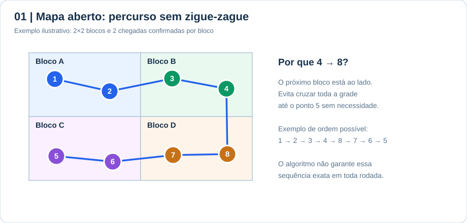
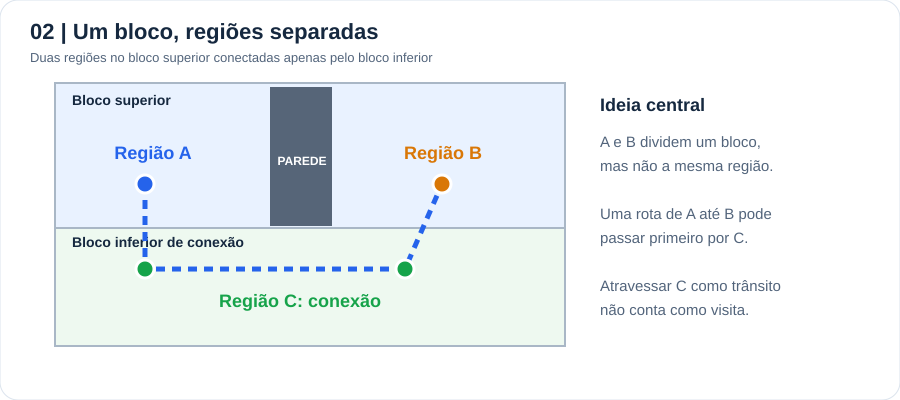
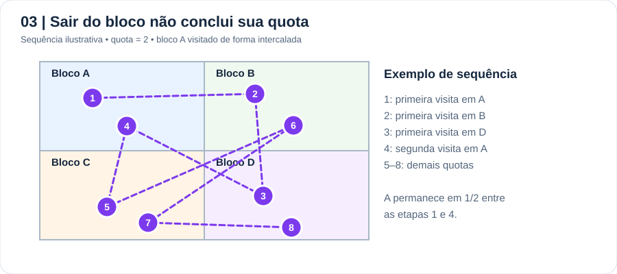
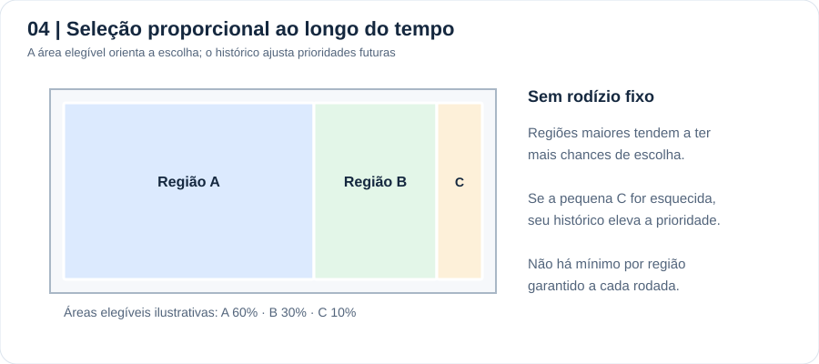
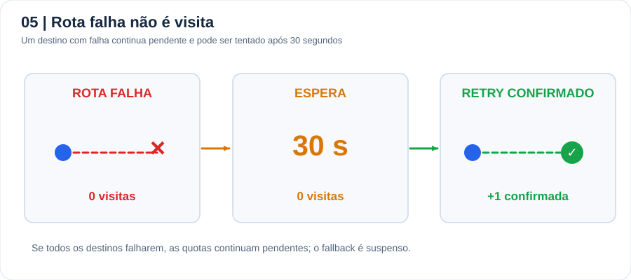
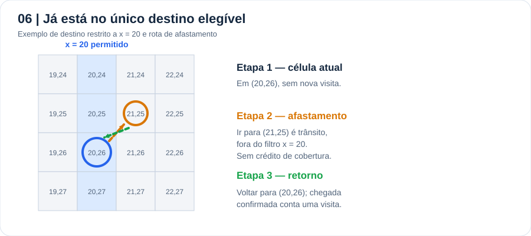

# 🗺️ lockMapSweep

**Exploração inteligente de mapas para [OpenKore](https://github.com/OpenKore/openkore)**
**Versão 2.1.0** · [English](README.md) | **Português**

O `randomWalk` do OpenKore faz o personagem caminhar, mas nem sempre distribui bem seus destinos pelo mapa. O **lockMapSweep** organiza essa exploração: divide a área navegável em blocos, reconhece caminhos e obstáculos, lembra quais partes ainda precisam de visitas e escolhe novos destinos levando em conta o deslocamento necessário.

**O plugin escolhe *onde* explorar; o OpenKore calcula e executa *como* chegar lá.** Não é uma rota fixa nem um substituto para as funções de combate, NPCs ou navegação geral.

## Comece por aqui

1. Coloque `lockMapSweep.pl` no diretório de plugins da sua instalação do OpenKore.
2. Configure o `lockMap` e o `randomWalk` normalmente em `control/config.txt`.
3. Adicione as opções abaixo para começar com uma grade de **3 × 3 blocos** e **2 destinos por bloco em cada rodada**:

   ```text
   lockMapSweep_enabled 1
   lockMapSweep_blocksX 3
   lockMapSweep_blocksY 3
   lockMapSweep_cellsPerBlock 2
   lockMapSweep_useStateFile 1
   ```

4. Inicie o OpenKore e use `lockMapSweep status` para consultar o planejamento.


## Entenda as três ideias principais

| Conceito | O que significa |
| --- | --- |
| **Bloco** | Uma parte da grade configurada. Cada bloco tem uma quantidade de destinos a visitar por rodada. |
| **Região** | Uma área conectada dentro de um bloco. Muros ou obstáculos podem dividir um mesmo bloco em várias regiões. |
| **Visita de cobertura** | Chegada confirmada a um destino escolhido pelo plugin. Apenas ela conta para cumprir a quantidade de visitas do bloco. |

Uma **rodada** termina quando as quotas dos blocos aplicáveis são cumpridas. Por exemplo: com quatro blocos e quota de duas visitas por bloco, o objetivo de uma rodada é registrar até oito chegadas de cobertura, respeitando a quantidade de destinos disponíveis em cada bloco.

**Passar por um lugar não é o mesmo que visitá-lo para cobertura.** O personagem pode atravessar um corredor, uma região ou um bloco já concluído apenas para chegar a outro destino. Esse movimento é **trânsito** e não aumenta nenhum contador de visitas.

## Exemplos visuais: do mapa simples ao avançado

As figuras são representações didáticas de possíveis decisões do planejador. As linhas mostram a ideia do deslocamento, não o caminho exato que o servidor executará. Os números ilustram uma sequência possível, não uma ordem obrigatória.

### 1. Mapa aberto: explorar por blocos



Imagine uma área aberta dividida em **quatro blocos**, com `lockMapSweep_cellsPerBlock 2`.

- O plugin escolhe células válidas dentro dos blocos.
- Cada chegada confirmada ocupa uma das duas visitas daquele bloco.
- Quando as quotas da rodada terminam, começa uma nova rodada de exploração.

**O benefício:** destinos deixam de ser escolhidos sem considerar as áreas já atendidas. Ainda existe aleatoriedade, mas com uma noção de progresso por bloco.

### 2. Mapa recortado: duas regiões no mesmo bloco



Uma parede separa as regiões **A** e **B** do bloco superior. Para ir de A até B, o personagem precisa descer até **C**, no bloco inferior, e subir pelo outro lado.

- O plugin reconhece A e B como regiões diferentes, apesar de estarem no mesmo bloco.
- Considera a passagem por C ao planejar como alcançar B.
- Se C servir somente de passagem, **nenhuma visita é creditada a C**.

**O benefício:** o personagem não precisa tentar atravessar uma divisão impossível só porque duas células estão no mesmo bloco. É assim que o planejamento lida com mapas “picotados”.

### 3. Blocos interrompidos: sair e voltar depois



Com duas visitas exigidas por bloco, o personagem pode fazer uma visita em **A**, seguir para **B** e **D** e só depois retornar a **A**.

- Sair de A quando ele está em `1/2` não reinicia seu progresso.
- O planejador continua sabendo que falta uma visita em A.
- Blocos já concluídos podem ser atravessados para acessar outros sem ganhar visitas extras.

**O benefício:** explorar não significa terminar obrigatoriamente um bloco antes de considerar os demais. O plugin aproveita oportunidades de deslocamento e mantém as pendências.

### 4. Regiões desiguais: cobrir sem esquecer os cantos



Suponha que as regiões **A**, **B** e **C** representem 60%, 30% e 10% dos destinos elegíveis. Em geral, regiões maiores terão mais oportunidades de escolha, mas o plugin também leva em conta o histórico para ajustar a prioridade das regiões pouco visitadas.

Isso **não** significa uma agenda de seis visitas em A, três em B e uma em C a cada dez destinos. As escolhas são probabilísticas, dependem do caminho disponível e podem mudar entre rodadas.

**O benefício:** regiões pequenas não desaparecem do planejamento só porque outras ocupam grande parte do mapa.

### 5. Destino falhou: tentar de novo sem perder a rodada



Se uma rota for interrompida ou falhar, o plugin **não** registra uma visita. O destino que falhou fica temporariamente fora das escolhas. Se todos os destinos elegíveis restantes também tiverem falhado, o plugin pausa as tentativas por **30 segundos**.

- Enquanto houver outros destinos elegíveis disponíveis, o plugin pode continuar a exploração sem repetir a rota que falhou.
- Após o intervalo, os destinos falhos podem voltar a ser considerados. As quotas pendentes são mantidas durante a espera, sem pedidos de rota repetidos.
- Se uma passagem continuar impossível, a obrigação permanece pendente; o plugin não inventa uma chegada para encerrar a rodada.

**O benefício:** uma falha momentânea de navegação não precisa apagar o progresso nem prender o personagem em tentativas incessantes.

### 6. Único destino: sair da célula e voltar



Imagine que a configuração só permita **um destino de cobertura**, a célula `(20,26)`. Depois de completar uma rodada, o personagem continua parado nela. Apenas permanecer ali **não** pode contar como nova visita.

O plugin procura uma célula caminhável próxima, move o personagem para uma posição de afastamento, por exemplo `(21,25)`, e depois retorna a `(20,26)`:

- **Afastamento:** é trânsito, então vale **zero visitas**.
- **Retorno confirmado:** vale **uma visita** na nova rodada.
- A posição de afastamento pode estar fora da restrição de **destinos** configurada, porque não está sendo usada como destino de cobertura.

A procura do afastamento é limitada a **oito passos de custo de rota**. Se não existir uma saída válida, o plugin mantém a visita pendente, informa o bloqueio e reconsidera a situação após 30 segundos.

**O benefício:** nem uma área de cobertura extremamente restrita consegue gerar visitas apenas deixando o personagem parado.

## Como ele escolhe o próximo destino?

O planejamento segue este raciocínio:

1. **Descobre onde é possível caminhar.** Usa as regras de movimentação do OpenKore para identificar a área conectada ao personagem e ignora ilhas inacessíveis.
2. **Divide o mapa.** Cria a grade de blocos e identifica as regiões separadas por obstáculos dentro deles.
3. **Consulta o que falta.** Verifica as visitas confirmadas de cada bloco e os destinos ainda disponíveis na rodada.
4. **Compara caminhos.** Considera regiões próximas, custos para chegar e seguir viagem, histórico de visitas e obrigações pendentes. Pode usar pontos intermediários de trânsito para alcançar regiões distantes.
5. **Pede a rota ao OpenKore.** O OpenKore executa o movimento com seu sistema normal de navegação.
6. **Atualiza após o resultado.** Uma chegada de cobertura confirmada conta; trânsito e rotas malsucedidas não. O plano é reavaliado conforme o personagem se desloca.

O planejador **não segue uma sequência fixa de blocos** nem garante encontrar a rota globalmente mais curta. Ele pode adiar uma região cujo desvio seja muito custoso, mesmo que exista conexão até ela.

### O que conta como visita?

| Acontecimento | Conta? |
| --- | :---: |
| Chegar ao destino de cobertura selecionado e confirmar o movimento | ✅ |
| Atravessar um bloco, corredor ou região no caminho | ❌ |
| Alcançar um ponto intermediário de trânsito estratégico | ❌ |
| Solicitar uma rota que ainda não terminou | ❌ |
| Falhar ou interromper uma rota | ❌ |
| Permanecer parado sobre a única célula elegível | ❌ |
| Sair dessa célula e retornar com chegada confirmada | ✅ |

## Configurações

| Opção | Padrão | Para que serve |
| --- | --- | --- |
| `lockMapSweep_enabled` | `0` | `1` ativa o plugin. |
| `lockMapSweep_blocksX` | `2` | Quantidade de blocos na horizontal. |
| `lockMapSweep_blocksY` | `2` | Quantidade de blocos na vertical. |
| `lockMapSweep_cellsPerBlock` | `3` | Máximo de visitas de cobertura confirmadas por bloco em cada rodada. Um bloco com menos destinos elegíveis pode ter quota menor. |
| `lockMapSweep_useStateFile` | `1` | `1` guarda o progresso entre execuções; `0` mantém o estado apenas em memória. |
| `lockMapSweep_stateDir` | `plugins/lockMapSweep/state` | Pasta dos arquivos de estado. |

### Como funciona junto com `lockMap`

O plugin respeita o mapa configurado em `lockMap`, as restrições `lockMap_x`, `lockMap_y`, `lockMap_randX` e `lockMap_randY` e as exclusões de destino fornecidas ao OpenKore pelo hook `add_dropDestinationCells`.

Essas restrições definem **onde uma visita de cobertura pode terminar**, não todas as células pelas quais o personagem pode passar. Por isso uma rota pode atravessar outros blocos ou corredores, e um afastamento temporário pode sair da área restrita sem ampliar os destinos válidos de cobertura.

O plugin só atua enquanto está ativado e o personagem está no `lockMap` configurado. Ele não muda o `lockMap`, não teleporta o personagem e não substitui as demais rotinas do OpenKore.

## Comandos do console

| Comando | O que faz |
| --- | --- |
| `lockMapSweep status` | Mostra o mapa, o estado do plano, o bloco atual e os contadores de visitas. |
| `lockMapSweep rebuild` | Refaz o planejamento usando o mapa e as configurações atuais. Se a reconstrução falhar, o último plano válido em memória é preservado, embora configurações incompatíveis possam pausar a exploração. |
| `lockMapSweep clearstate` | Apaga o arquivo de estado salvo, **sem zerar imediatamente** o planejamento que está em memória. O arquivo pode ser criado novamente em uma gravação posterior. |

## Progresso salvo e situações especiais

Com `lockMapSweep_useStateFile 1`, o plugin pode retomar visitas confirmadas, pendências por bloco, histórico das regiões, destinos que falharam e rotas em andamento. Ele também salva as etapas de afastamento e retorno quando necessárias.

Ao iniciar, confere se o estado salvo combina com o mapa e as configurações atuais. Se o arquivo estiver incompatível ou inválido, reconstrói o planejamento em vez de usar informações incorretas. Alterações na geometria, na grade ou nas restrições podem, portanto, reiniciar o progresso registrado.

## Compatibilidade

O lockMapSweep usa hooks de plugins do OpenKore, dados de caminhabilidade do mapa (`.fld2`) e as interfaces nativas de `randomWalk`/`ai_route`. A instalação do OpenKore precisa fornecer essas interfaces e os dados do mapa configurado. O plugin estima conectividade e custos de deslocamento para planejar; o OpenKore continua escolhendo e executando cada rota nativa, então os caminhos estimados não garantem o movimento exato nem uma chegada bem-sucedida.

**Por que o personagem pode ficar sem escolher um destino?** As causas incluem destinos temporariamente falhos aguardando nova tentativa, uma região conectada mas muito custosa no momento ou a falta de uma célula válida para afastamento. Em alguns casos o OpenKore ainda pode recorrer ao seu `randomWalk` normal; nos estados de recuperação bloqueada, o plugin evita esse fallback para não criar movimentação descontrolada.

**O que o plugin não promete:** visitar todas as células do mapa, distribuir exatamente a mesma quantidade de visitas entre regiões, acessar áreas fisicamente desconectadas ou conseguir concluir rotas que o OpenKore/servidor não permitem.

## Changelog

### 2.1.0 — Planejamento global por regiões

- Os blocos agora podem conter **várias regiões conectadas separadamente**, inclusive quando é necessário atravessar outro bloco para alcançar uma delas.
- O planejamento deixou de depender de concluir cada bloco antes de sair: **visitas parciais permanecem pendentes** e podem ser retomadas depois.
- A escolha de destinos passou a considerar **histórico proporcional por região**, custos de deslocamento e **trânsito estratégico** entre partes do mapa.
- O progresso salvo agora inclui as informações necessárias para retomar **quotas, histórico regional, rotas pendentes e recuperação de falhas**.
- Destinos com rotas malsucedidas podem ser reconsiderados após **30 segundos**, sem contabilizar tentativas como visitas.
- Quando o personagem já está no único destino elegível, a próxima visita exige **afastamento e retorno reais**, não apenas permanecer sobre a célula.

### 2.0.0 — Navegação por blocos e chegadas confirmadas

- Divisão configurável do mapa em blocos e seleção de destinos caminháveis.
- Progresso contabilizado por **chegada confirmada**, não pelo simples pedido de rota.
- Respeito às restrições de destino, reação a mudanças do mapa/configuração e recuperação básica de rotas interrompidas.
- Persistência com verificação de compatibilidade e gravação segura do arquivo de estado.

---

*O lockMapSweep organiza destinos de exploração. A execução dos caminhos continua sendo responsabilidade do OpenKore e do servidor.*
